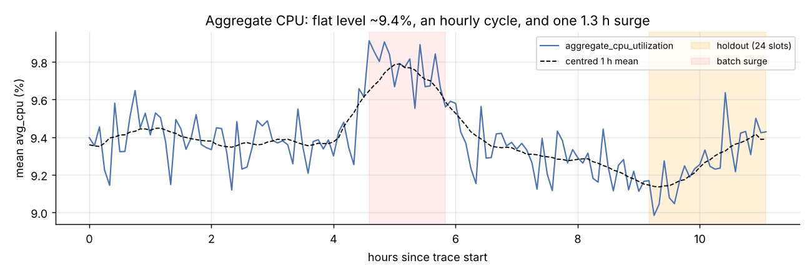
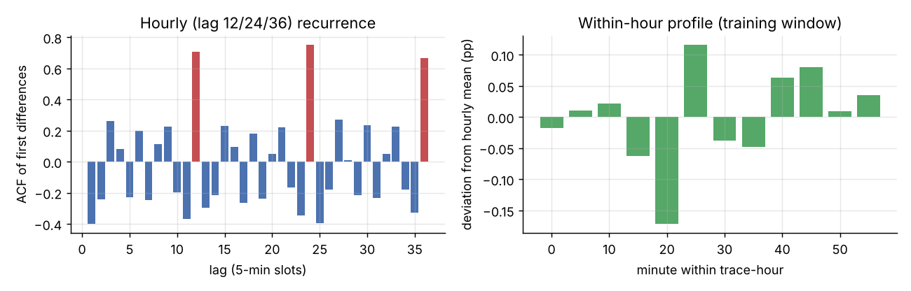
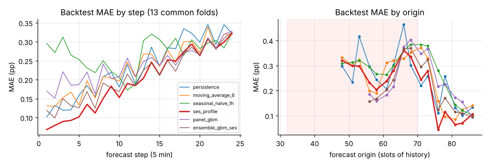
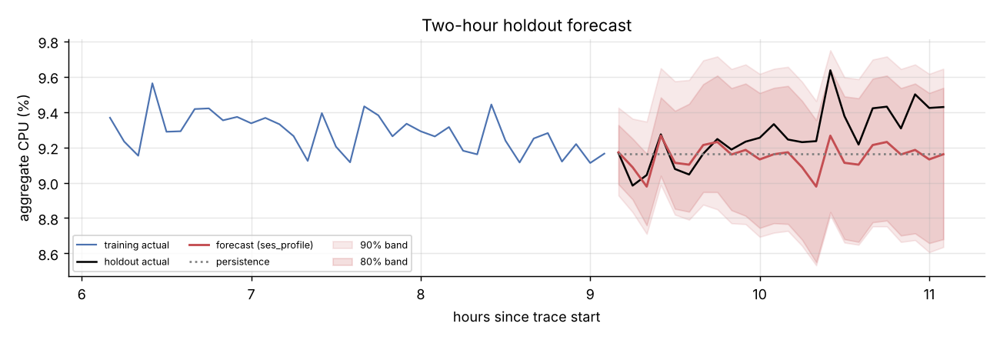

# Cloud Workload Forecasting on Azure VM Traces

Sid Pujari · Atomity AI/ML take-home · dataset `data-v1` (10,000 VMs × 134 five-minute slots)

Every number below comes from `notebooks/analysis.ipynb`. The submission comes from `python -m cwfc.predict`.

---

## 1. Executive summary

**How predictable is the workload?** At fleet level it is very stable. Aggregate CPU stays at 9.39% ± 0.19 pp over 11.1 hours, a coefficient of variation of 2.1%. Individual VMs vary far more: the median per-VM CV is 0.29. Averaging 10,000 VMs cancels most of that idiosyncratic noise. What remains has two parts:

- **A predictable hourly cycle.** The ACF of first differences is 0.71 at lag 12. About 5% of VMs (cron or batch style) cause all of it.
- **Level shifts that can't be predicted.** One 1.3-hour surge added +0.39 pp. 1% of VMs caused 62% of it. These shifts account for 73% of the squared forecast error.

**How accurately can we forecast 2 hours ahead?** The selected model, `ses_profile`, combines an exponentially smoothed level with a within-hour profile.

- **Backtest:** MAE 0.198 pp (WAPE 2.1%), 15% lower than persistence. It beats persistence on 62% of rolling origins. In the first 30 minutes it is 31% better (MAE 0.094 vs 0.136).
- **Holdout:** MAE 0.140 pp (WAPE 1.5%), 5% better than persistence. The first hour was very accurate (MAE 0.059). The second hour was under-forecast by 0.22 pp because the level started rising.
- **`active_vm_count`:** forecast exactly (10,000, zero error). This is not a modelling success. The release kept only VMs with complete traces, so there is zero churn in this window by construction.

**What should infrastructure do?** Provision at **forecast + the 90th-percentile backtest residual for each step**. That is about +0.15 pp of headroom at 5 minutes and +0.38 pp from 1 hour onward, roughly +96 vCPUs on a 28.4k-vCPU pool. Re-forecast every 5 minutes. Add a surge trigger when a one-step residual exceeds a robust z-score of 3.

On the holdout this policy had **zero shortfall with 0.22 pp average headroom**. Static training-max provisioning needed 0.64 pp, and a flat 5% margin needed 0.34 pp. τ = 0.9 is the cost-minimising quantile when a shortfall costs 9× more than idle capacity.

A VM-level ML model trained on 1.5M rows improved per-VM accuracy by 16% but did **not** improve the aggregate forecast. Section 7 explains why.

## 2. Data understanding and preprocessing

| Check | Result |
|---|---|
| Rows / VMs / timestamps | 1,340,000 / 10,000 / 134 (t = 0 … 39,900 s) |
| Cadence | Every gap is exactly 300 s. No off-grid timestamps. No empty slots. |
| Missing / invalid / duplicate | 0 / 0 / 0. `min ≤ avg ≤ max` holds everywhere. |
| Coverage | Every VM has all 134 slots. The CPU and metadata VM sets match one-to-one. |
| VM creation | `timestamp_vm_created = 0` for every VM. They all existed before the window, and the creation time is left-censored. |
| VM deletion | 0 deletions inside the window. 17.9% are deleted later in the 30-day trace (median 8.5 days after the start). |

**Implication: there is no churn, by construction.** Only VMs with complete 134-slot traces were eligible, so the sample is survivorship-biased toward long-lived VMs. `active_vm_count` is therefore a constant 10,000. Its forecast is trivial and says nothing about real fleet churn. A real capacity system would need arrivals and deletions modelled from the full trace.

**Target construction** (`cwfc.data`):

- A valid observation has a finite `avg_cpu` in [0, 100].
- Duplicate `(vm_id, timestamp)` rows are averaged, so a VM is counted at most once per slot.
- Targets are built on a regular 300 s grid that spans the observed range.
- An empty slot gets `active_vm_count = 0` (what was literally observed) and `aggregate_cpu_utilization = NaN`. It is never imputed as a target.
- Model inputs forward-fill from the past only.
- Off-grid readings are floored to the slot that contains them.
- The full series is built first. The holdout is then the last 24 *observed* timestamps.

None of these rules fire on data-v1. They are there because the pipeline must also work on an arbitrary smoke dataset, and the tests check this.

**A leakage trap in the metadata.** The metadata columns `avg_cpu`, `max_cpu` and `p95_max_cpu` summarise each VM's whole 30-day life. The metadata `avg_cpu` correlates 0.87 with the VM's mean over this window, so these columns are partly future information. They are excluded from all models, and so is `timestamp_vm_deleted`. Only the provisioning attributes are used: category, core bucket and memory bucket.

## 3. Workload analysis

**Distributions.** Readings are heavily right-skewed. The median `avg_cpu` is 5.1%, p95 is 37%, and p99 is 87%. 46% of VMs average below 5% and only 2.2% average above 50%. Load is fairly concentrated: the busiest 10% of VMs produce 44% of the CPU. On average 2.9% of VMs hit a 5-minute `max_cpu` above 80% (maximum 4.5%).

Operationally, the sampled fleet is mostly idle. The capacity risk sits in a few hot VMs and in bursts *within* each interval: the mean of per-VM `max_cpu` peaks at 20.0%, against 9.9% for `avg_cpu`. Fleet-average headroom is not where the risk is.

**Hourly recurrence.** The series has a clear 60-minute cycle measured from the trace start. There is a −0.17 pp dip at minute 20 and a +0.12 pp spike at minute 25. The real clock time is unknown, because the trace only gives seconds since its start. The top 1% of VMs by hourly swing produce 42% of the aggregate swing, and the top 5% produce all of it. This looks like scheduled jobs.

**The surge (hours 4.6–5.8, slots 55–70).** The 1-hour mean rose by 0.39 pp, then decayed over about 2 hours to a low near 9.15% at hour 9. The 100 VMs that contributed most account for 62% of the surge. They come from 41 deployments, and 79% of the surge was Delay-insensitive.

This was a batch event, not a fleet-wide change. Its onset is the only sustained anomaly flagged by a one-step-ahead robust z-score scan (z = 6.9 at slot 55). Nothing in the preceding aggregate history signalled it. Every slot in the top decile of the series falls inside this surge.

**Segments.**

| Segment | VMs | Mean CPU | Aggregate CV | Hourly ACF(12) | Share of VMs > 80% max |
|---|---:|---:|---:|---:|---:|
| Delay-insensitive | 6,180 | 8.2% | 0.025 | **0.73** | 2.2% |
| Interactive | 3,091 | **11.5%** | 0.023 | 0.47 | **4.0%** |
| Unknown | 729 | 10.2% | **0.063** | 0.49 | 4.2% |

- **Delay-insensitive:** lowest utilisation and the strongest hourly regularity.
- **Interactive:** hotter, with twice the hot-VM share, and its hourly cycle is less regular. This segment is where under-provisioning hurts users.
- **Unknown:** the smallest segment, so its aggregate is the noisiest.
- **Core-weighted utilisation:** 9.29%, about 2,640 busy vCPUs out of 28,396. The `>24` bucket is assumed to be 32 vCPUs. It tracks the unweighted target closely (correlation of differences 0.96), so the required target is a reasonable proxy for capacity.

## 4. Forecasting approach

All models forecast at the native 5-minute cadence and use a direct 24-step horizon, so there is no resampling or mapping back.

- **Baselines.** Persistence, moving averages (6/12/24 slots), seasonal-naive with a 1-hour season, and linear drift over 2 hours.
- **`seasonal_profile`.** A within-hour profile estimated on the history: mean deviation from a centred 1-hour mean for each phase, shrunk by n/(n+2). Added to a de-seasonalised 1-hour mean level.
- **`ses_profile` (selected).** The same profile, plus simple exponential smoothing of the de-seasonalised series. The smoothing weight α is chosen by in-sample one-step SSE at each origin; it ranges from 0.2 to 0.7. This is effectively an ETS(A,N,A) model with a fixed seasonal component. It is cheap, needs no tuning on validation data, and handles slow level drift better than a fixed window.
- **`panel_ridge` / `panel_gbm` (ML).** The aggregate has only 110 training points, but it averages 10,000 VM series. One global model is trained across VMs to predict each VM's `avg_cpu` h steps ahead. That gives about 1.5M rows from 2,500 sampled VMs × anchors × horizons. The VM forecasts are then averaged.
  - **Features**, all computed at the anchor: last value and 2 lags; means over 3/6/12/24 slots and the full history; 1-hour standard deviation and slope; EWMs with α = 0.1/0.3/0.6; the same-phase value from the previous hour and the mean over the previous 4 hours; target phase; horizon; category, core and memory codes.
  - **Target:** the residual from the VM's EWM(0.3) level.
  - The learner is sklearn `HistGradientBoostingRegressor`, or ridge.
- **`ensemble_gbm_ses`.** The mean of `panel_gbm` and `ses_profile`.
- **`active_vm_count`.** Persistence, a 1-hour mean, or drift. Empty slots are treated as missing telemetry, not as zero VMs.

**Information availability.** Every feature uses slots up to and including the anchor. Phase features come from timestamps, which are known for any future slot. Static VM attributes are known when the VM is provisioned.

## 5. Validation methodology

- **Expanding-window rolling origin, inside the 110-slot training window only.** There are 16 origins at history lengths 48, 51, …, 86. Each one forecasts slots o+1 … o+24, which is the same task as production: everything up to now, then the next 2 hours. The last origin's window ends at slot 109, so no fold touches the holdout.
- **Common support.** The panel models need at least 56 slots of history. Model comparison therefore uses the 13 origins every candidate can run on.
- **Selection rule (fixed before the holdout was looked at).** The lowest mean backtest MAE wins. Within 1%, the simpler model is preferred.
- **Holdout.** Scored once, after `predictions.csv` was written, by a separate module (`cwfc.evaluate`). Nothing in the prediction path imports it.
- **Leakage test.** A unit test replaces every holdout-window reading with random values, drops 30% of them, and checks the submission doesn't change.
- **Caveat.** The folds overlap heavily, 11 hours contain only one surge, and backtest metrics are correlated across folds. With differences this small, rankings that are only a few percent apart are not statistically meaningful.

## 6. Results versus baseline

**Backtest, 13 common folds × 24 steps.** "Peak" means slots in the top decile of actuals on these folds.

| Model | MAE (pp) | RMSE | WAPE | MAE / persistence | Bias | Peak MAE |
|---|---:|---:|---:|---:|---:|---:|
| **ses_profile** | **0.198** | **0.251** | **2.10%** | **0.85** | −0.19 | **0.068** |
| ensemble_gbm_ses | 0.210 | 0.253 | 2.24% | 0.90 | −0.19 | 0.110 |
| moving_average_6 | 0.231 | 0.283 | 2.46% | 0.99 | −0.19 | 0.149 |
| persistence | 0.233 | 0.286 | 2.48% | 1.00 | −0.21 | 0.101 |
| panel_gbm | 0.238 | 0.279 | 2.53% | 1.02 | −0.18 | 0.202 |
| seasonal_profile | 0.247 | 0.284 | 2.63% | 1.06 | −0.19 | 0.222 |
| seasonal_naive_1h | 0.269 | 0.317 | 2.87% | 1.16 | −0.19 | 0.309 |
| panel_ridge | 0.300 | 0.350 | 3.19% | 1.29 | −0.27 | 0.137 |
| drift_24 | 0.438 | 0.542 | 4.66% | 1.88 | −0.24 | 0.161 |

`ses_profile` gains the most early in the horizon. MAE for steps 1–6 is 0.094 vs 0.136 for persistence, steps 7–12 is 0.162 vs 0.198, and steps 13–24 is 0.267 vs 0.298. Seasonal-naive alone is worse than persistence, because copying last hour also copies last hour's noise. The cycle has to be averaged over several hours before it helps.

**Holdout (final 24 slots).** The selected model scored MAE 0.140, RMSE 0.176, WAPE 1.51% and bias +0.12. Persistence scored MAE 0.147, so the ratio is 0.95. `active_vm_count` had MAE 0.

The 80% and 90% bands covered every holdout point. They are conservative, because the backtest residuals include the surge. For transparency, every candidate was also scored on the holdout. `seasonal_profile` (0.115) and `moving_average_24` (0.117) did best there, and `panel_gbm` did worst among the non-drift models (0.165). That is a single correlated 2-hour window, and the ranking reverses the 13-fold backtest. It doesn't justify changing the selection, which would also be holdout-based model selection.

## 7. Error and failure analysis

1. **Errors are mostly level shifts, not shape.** 73% of `ses_profile`'s backtest squared error is the mean error of each fold. The backtest bias is −0.19 pp (over-forecast) because most folds forecast into the post-surge decline. On the holdout it is the reverse: +0.22 pp of under-forecast in the second hour as the level recovered. Any model with a flat level will lag regime changes. This is the main way it fails.
2. **Peaks are where it fails, and the timing matters.** On all 16 folds, top-decile slots have MAE 0.291 and bias +0.287. Peak demand is under-forecast. Every peak is a surge slot, and origins *before* the onset (48–53) miss it completely. Once the surge has started, the smoothed level adapts within a few slots: on the common folds, peak MAE is just 0.068. The largest holdout miss is slot 125 (actual 9.64%, forecast 9.27%), a one-slot spike with no precursor.
3. **Error grows with lead time.** Holdout MAE was 0.059 in the first hour and 0.221 in the second. Backtest MAE roughly triples from step 1 to step 24. A 2-hour forecast is mostly a level estimate plus a known within-hour shape.
4. **Why the ML model doesn't help the aggregate.** On the last fold, `panel_gbm` cuts **VM-level** MAE from 2.36 to 1.97 pp, 16% better than persistence. Its aggregate is still no better on average. Most of what it learns is mean reversion of each VM's own noise, and that noise already cancels when 10,000 VMs are averaged. The aggregate error comes from *correlated* shifts across hundreds of VMs, like the batch surge, and nothing in each VM's own history predicts those. `panel_gbm` did win the early folds (56–63), where per-VM mean reversion after the surge onset mattered. It lost on the steadier later folds. Blending it with `ses_profile` didn't beat `ses_profile` alone.
5. **Within-hour phase.** Errors are fairly even across phases (MAE 0.17–0.31 pp). The worst is minute 35, just after the scheduled spike, where spike amplitude varies from hour to hour.
6. **Segments (extension).** Forecasting each category on its own, `ses_profile` still ranks first in every one. The gain over persistence is 9% for Delay-insensitive, 26% for Interactive and 6% for Unknown. The approach generalises across segments. Smaller segments are noisier: WAPE is 3.2–3.4% for Delay-insensitive and Unknown versus 2.1% for the whole fleet.

## 8. Capacity-planning recommendation

**Policy.** Provisioned capacity(t+h) = forecast(t+h) + Q_τ(h), where Q_τ(h) is the τ-quantile of backtest residuals at step h. Bands are pooled over ±3 steps and made monotone, so headroom never shrinks with lead time.

Choose τ with the newsvendor rule, τ* = c_under / (c_under + c_over). If a shortfall (throttling, SLA risk) costs 9× an idle unit, τ* = 0.9.

| Policy (holdout, cost ratio 9:1) | Shortfall slots | Mean shortfall | Mean headroom | Cost / slot |
|---|---:|---:|---:|---:|
| forecast + Q0.50 | 88% | 0.252 | 0.004 | 2.27 |
| forecast + Q0.80 | 58% | 0.083 | 0.031 | 0.78 |
| **forecast + Q0.90** | **0%** | **0** | **0.218** | **0.22** |
| forecast + Q0.95 | 0% | 0 | 0.336 | 0.34 |
| forecast + 5% relative margin | 0% | 0 | 0.338 | 0.34 |
| persistence + 5% margin | 4% | 0.001 | 0.354 | 0.36 |
| static: training-window max | 0% | 0 | 0.643 | 0.64 |

The backtest gives the same ordering. There, Q0.90 has the lowest cost (0.52) with a 9% shortfall rate, but that comparison is in-sample because the quantiles were calibrated on the same folds.

**Recommended operating rules:**

1. **Base rule.** Provision at forecast + Q0.90 per step, and refresh every 5 minutes. Headroom is about +0.15 pp at 5 minutes and +0.38 pp from about 1 hour on, which is +40 to +110 vCPUs on this 28.4k-vCPU sample. Only act on steps the scaling system can't react to faster. If capacity can be added in 15 minutes, the relevant headroom is the step-3 band, not the step-24 band.
2. **Surge trigger.** If the one-step-ahead residual exceeds a robust z of 3 (as at slot 55), assume a batch surge has started. Raise headroom by one surge size (about 0.4 pp) for the next hour. The model adapts within a few slots, but the first slots of a surge are the expensive misses.
3. **Segment rule.** Use τ = 0.95 for Interactive capacity, which is latency-sensitive and has twice the hot-VM share. Use τ ≈ 0.8 for Delay-insensitive capacity. Those jobs can be queued or throttled, and they also drive the hourly minute-25 spike, so they can be moved off that spike instead of buying capacity for it.
4. **Size bursts separately.** Average utilisation is half of peak-within-interval utilisation (9.9% vs 20%). Host packing and oversubscription ratios should be planned on a forecast of `max_cpu`. The `avg_cpu` forecast is for fleet-level energy, budget and pool size.

**The trade-off.** A higher τ buys fewer shortfalls with idle capacity. Q0.80 → Q0.90 removed every holdout shortfall for +0.19 pp of headroom. Q0.90 → Q0.95 bought nothing more on the holdout for +0.12 pp. Under-provisioning risks throttling and SLA breaches concentrated on the busiest VMs. Over-provisioning wastes money but is reversible. That asymmetry is why τ ≥ 0.9 is right for user-facing capacity.

## 9. Limitations and future work

- **11.1 hours only.** No daily or weekly seasonality can be estimated, and the real time of day is unknown. Phase features are relative to the trace start. With the full 30-day trace I would add daily and weekly profiles (seasonal ETS or TBATS-style) and calendar features.
- **Survivorship selection.** There is no churn, so `active_vm_count` can't be evaluated meaningfully. A real count forecast would model arrivals and deletions from the full trace by deployment.
- **One surge, overlapping folds.** Rankings that differ by less than about 10% are not significant. The interval bands carry the backtest period's negative bias. Rolling conformal recalibration on a longer history would fix that.
- **Unpredictable level shifts dominate the error.** The most promising direction is detecting them early, not better point models: change-point detection on deployment- or subscription-level aggregates, where a batch surge starts as a large, clear signal before it is diluted across 10,000 VMs.
- **Capacity proxy.** The required target is an unweighted mean. Core-weighted demand and the mean of `max_cpu` are better capacity signals, and the `>24` core bucket had to be assumed as 32 vCPUs.
- **Not done:** cross-cloud comparison (Google ClusterData2019) and hierarchical reconciliation across segments.

---

*Reproduce:* `pip install -e ".[dev,analysis]"`, then `python -m cwfc.predict --data challenge_data --output predictions.csv`, then `python -m cwfc.evaluate`, then `jupyter nbconvert --execute --inplace notebooks/analysis.ipynb`.
